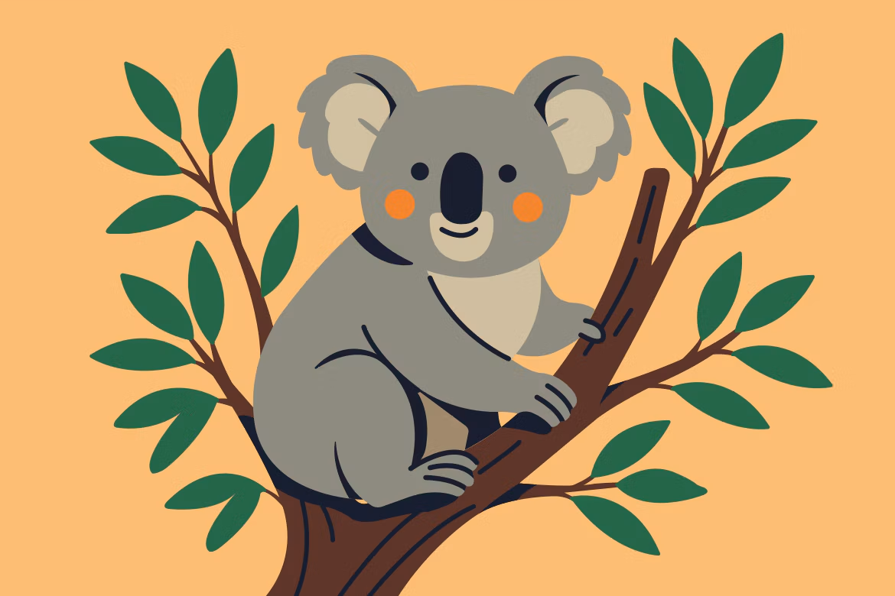

<div align="center">

# Pyaint

**Transform any image into automated brush strokes.**

Pyaint recreates a picture by driving the mouse in a painting app — MS Paint,
skribbl.io, and anything else with an on-screen palette you can teach it.

[](LICENSE.md)
[](#quick-start)

[Quick start](#quick-start) • [How it works](#how-it-works) • [FAQ](#faq) • [Contributing](CONTRIBUTING.md)

</div>

---

## Demo

https://github.com/user-attachments/assets/50f2f344-8ca9-439b-8722-0175356ad59e

<sub>MS Paint — sampled palette and double-click colour mode.</sub>



<sub>The bundled sample Pyaint opens with — a koala by Ahmed Hossam via
[Unsplash](https://unsplash.com/illustrations/a-cute-koala-climbs-a-tree-branch-5csXP8McYiA)
(Unsplash License).</sub>

## What it does

- **Recreates any image** by painting it with the mouse, stroke by stroke.
- **Works with palette-only apps.** Pyaint samples colours from the target's
  on-screen palette, so it does not need an API or a plugin.
- **Plans before it paints.** Source, planned result and a side-by-side Compare
  view update as you tune the settings, and repeat runs can skip processing.

It is for drawing your own images in apps you control: art, accessibility,
offline demos, and testing. See [Intended use](#intended-use).

## Quick start

**Requirements:** Windows 10/11 and a drawing app with an on-screen palette.
The `.exe` needs nothing else; a source checkout needs Python 3.8+.

### 1. Install

**Option A — download the `.exe`:** grab `pyaint.exe` from
[Releases](https://github.com/Trev241/pyaint/releases/latest). No Python needed.

**Option B — pipx:**

```bash
pipx install git+https://github.com/Trev241/pyaint.git
pyaint
```

**Option C — from source:**

```bash
git clone https://github.com/Trev241/pyaint.git
cd pyaint
python -m venv .venv
.venv\Scripts\activate
pip install -r requirements.txt
python main.py
```

### 2. Draw

1. Open the target app on a **blank** canvas. Maximize it on the primary
   monitor at **100% display scaling**, then choose it in **Drawing in**.
2. Click **Find the canvas**, review the detected regions on screen, and confirm.
   If detection fails, click **Pick the regions** and click the canvas and
   palette corners yourself.
3. Pick an image. On first run the bundled koala is already loaded; otherwise
   drop a file, paste a URL, or type words to search online. **Source** chooses
   Openverse (default) or Wikimedia Commons for searches.
4. Check **Source / Preview / Compare**. Choose the mode and **Look** in the
   column, then expand **Drawing** for detail and pacing. The preview updates
   as you go.
5. Click **Start drawing**. Press `ESC` to stop, `P` to pause/resume.

That's it. For skribbl.io the first draw takes about a minute.

> **Display scaling / multi-monitor:** `pyautogui` captures the primary monitor
> at physical pixels. Set Windows scaling to 100% on the target monitor, or
> expect screenshot↔click coordinates to drift.

> **Honest note:** auto-detection is tuned against specific window layouts and
> resolutions. When it cannot find a region it falls back to manual teaching,
> so always review the on-screen overlay before applying.

## How it works

```
image  →  fit + scale to the canvas
       →  map each pixel to the nearest palette colour
       →  encode strokes (scan-line runs or traced contours)
       →  replay them with pyautogui, selecting colours as it goes
```

Four drawing modes, grouped in the **Mode** rail:

| Family | Mode | What it draws |
|--------|------|---------------|
| **Runs** | **Layered** | Colour runs, with lower layers merged away: fewer strokes, faster, smoother joins |
| **Runs** | **Slotted** | Every run exactly as planned: no overdraw, more strokes |
| **Contours** | **Outline** (default) | Region boundaries as continuous, human-paced polylines |
| **Contours** | **Edge tracing** | Black line art from the image's edges (no colour fills) |

**Look** presets: *Balanced*, *Smooth* and *Fast draft* for the fill modes set
pacing only; *Cartoon* and *Realistic* for Edge tracing set the edge cleanup
(merge by colour, smoothing, weak-edge pruning). Editing a knob switches the
panel to *Custom*.

**Live preview.** Preview plans on a worker thread as settings change, debounced
and cancelled by generation, so a moving slider never applies a stale frame.
**Compare** shows source and plan side by side.

**Cache.** A finished plan is stored in `cache/{image_hash}_{settings_hash}.json`
and reused while the image, canvas, settings and age (24 h) still match. It
skips processing, not drawing.

### Architecture and tools

| Layer | Module | Responsibility |
|-------|--------|----------------|
| UI | `pyaint/ui/` | PySide6 window, worker threads, preview, setup |
| Planner | `pyaint/planner.py` | **Pure**: image → colour grid or contours → stroke map |
| Executor | `pyaint/bot.py` | `Bot` facade and `Bot.draw`: pause/resume, progress, replay |
| Driver | `pyaint/painter.py` | `ScreenPainter`: screen capture + synthetic input |

Supporting modules: `profile.py` (the taught environment), `targets.py`
(recipes), `locators.py` (auto-detection), `palette.py` (swatch sampling and
nearest colour), `render.py` (preview frames), `cache.py` (stroke cache),
`config.py`/`paths.py` (persistence).

The key rule is that **the planner never branches on app identity**. An app
difference is either a declarative recipe (data) or a `ScreenPainter` seam
(code). `MainWindow` owns one `Profile` and hands the same object to `Bot`, so
the UI and the engine always agree on where the canvas, palette and buttons
are. `config.json` is split on load into the **environment** (`Profile`) and
**preferences** (`MainWindow`), then merged again on save.

## Supported apps

Pyaint finds the canvas and palette on screen, then replays the image. Support
depends on how much of the target can be detected.

| App | Support | Setup |
|-----|---------|-------|
| **skribbl.io** | Canvas + fixed 2×13 palette auto-detected | `Find the canvas` — no manual picking |
| **MS Paint** (Windows 11) | Canvas + palette auto-detected when maximized at 1920×1080 | `Find the canvas`, or pick manually |
| **Anything else with a palette grid** | Generic path | Teach the palette and canvas |

Pyaint selects colours from an **on-screen palette**, so apps whose only colour
picker is a dialog (GIMP, Clip Studio Paint, Photoshop) are not supported.
Support for another palette app is a data change, not a code change: see the
schema in [`targets/README.md`](targets/README.md).

## FAQ

**Why does Pyaint open with a koala?**
It is the bundled sample, shown only when there is no remembered image. Load
your own image and it replaces the sample; **Reset all settings** brings the
sample back. The sample is never copied into `last_image.png`.

**Does it work on macOS or Linux?**
No. Pyaint relies on Windows screen capture and `pyautogui` input, and the
detection is tuned for Windows apps.

**Drawing doesn't start.**
Check that the canvas and palette are configured (`Find the canvas` or
`Pick the regions`), that an image is loaded, and that a run is not already in
progress. Click **Start drawing** to see the missing step.

**Colours are wrong.**
Re-run **Find the canvas** (or pick the palette) so the swatch centres are
sampled correctly — the detection overlay draws a dot at each cell centre.
Lower **Detail** for finer detail.

**Colours are skipped entirely.**
Pyaint only draws colours that exist in the sampled palette. Others map to the
nearest swatch, and a colour with no close match may be skipped.

**Find the canvas found nothing.**
The canvas must be **blank** — existing artwork defeats detection. Also make
sure the window is maximized on the primary monitor at 100% display scaling.
Clear the canvas and retry, or use **Pick the regions**.

**Drawing is too slow / too fast.**
Adjust **Detail**, **Time per stroke** and **Stroke speed**. Lower **Detail**
means fewer, bigger strokes. **Save the plan for next time** skips processing
on repeat runs but does not change drawing speed.

**How do I stop or pause?**
`ESC` stops the current run and `P` pauses/resumes. The UI stays responsive
because the engine runs on a worker thread.

**Where does it save data?**
`config.json`, `cache/` and `targets/` sit next to the executable (the repo
root for a source checkout). Nothing is uploaded; the network is used only to
fetch an image you give it by URL, or to search Openverse / Wikimedia Commons
when you type search words.

**How do I reset everything?**
Click **Reset all settings** at the bottom of the settings column. That
deletes `config.json`,
the taught positions, the remembered image and the caches.

**Can I use this on skribbl.io?**
Locating the app's UI to draw your own image is allowed here, but using it to
deceive other players is not the intended use. See [Intended use](#intended-use).

## Development

```bash
pip install -e ".[dev,build]"
python -m pytest -q            # fast, headless suite
python -m pytest -m ui         # Qt smoke tests (offscreen)
python main.py                 # GUI (Windows)
python scripts/build_exe.py    # build dist/pyaint.exe
```

The tests never touch the screen: `Palette` is built from an explicit colour
map and screen actions are replaced with fakes. The build is Windows-only and
produces a single `dist/pyaint.exe` that bundles Python and all dependencies.

Setup, test, build and release details live in
[`CONTRIBUTING.md`](CONTRIBUTING.md).

## Intended use

Pyaint is for drawing your own images in applications you control: art,
accessibility, offline demos, and testing. It is **not** a tool for deceiving
people or defeating anti-cheat systems, and contributions that hide automation
(input spoofing, anti-detection "humanization") are out of scope. You are
responsible for complying with the terms of service of any app you use it with.

## License

GNU General Public License v3.0 or later — see [`LICENSE.md`](LICENSE.md).
